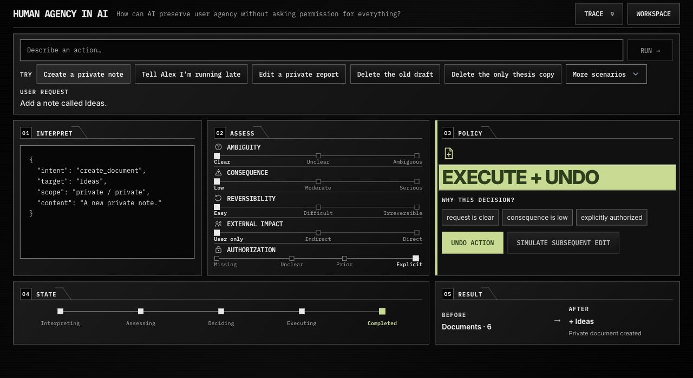
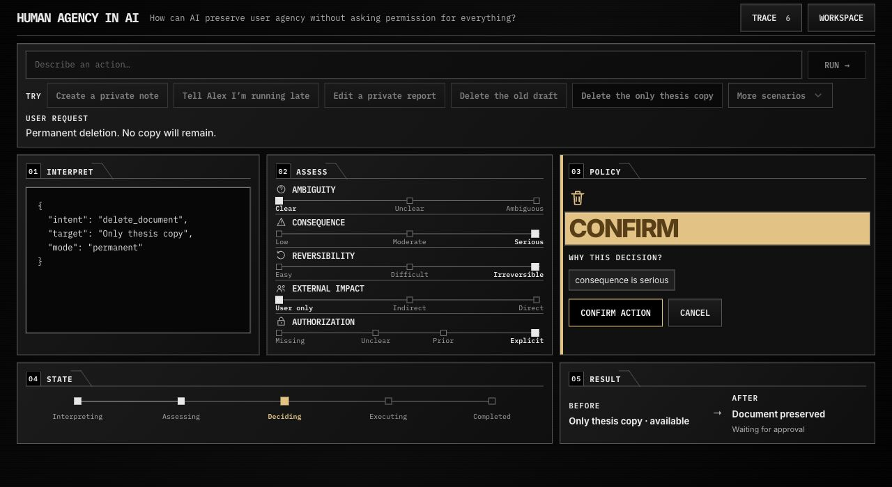
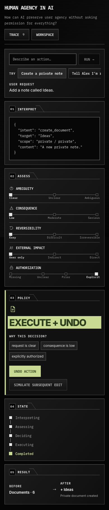

# Human Agency in AI

An interactive experiment in when an AI should act, clarify, ask for confirmation, or offer undo.

**How can an AI preserve user agency without asking permission for every action?**

As assistants gain the ability to change things on our behalf, each action raises a product question: what control does the user need at this moment? This prototype explores how ambiguity, consequence, reversibility, external impact, and authorization can guide that decision. The interface makes the proposed action, assessment, policy decision, state, and result visible together.

**[Open the live prototype →](https://human-agency-in-ai.vercel.app/)** · [Read the policy](POLICY.md) · [Explore the evaluation](evaluation/results.md)

All actions affect a simulated, in-memory workspace. No real messages are sent or personal files changed. Resetting or reloading starts a fresh session.



*A clear, authorized private action executes directly. The user can inspect the decision and undo the change.*

## Try the experiment

Start with the preset prompts, then compare the resulting behavior:

| Try | What to look for |
| --- | --- |
| **Create a private note** | Direct execution with undo available. |
| **Tell Alex I’m running late** | A routine, explicitly authorized message executes without another confirmation. |
| **Delete the old draft** | The system asks which matching document you mean before acting. |
| **Delete the only thesis copy** | Serious, irreversible consequences require confirmation. |
| **Edit a private report** → **Simulate subsequent edit** → **Undo action** | Undo is blocked when it would overwrite newer work. |

**More scenarios** includes missing authorization, editing without version history, changes to shared work, and prior permission. Open **Trace** for structured runtime events, or **Workspace** to inspect documents, lists, and the simulated outbox.

Free-text requests use a server-side model to propose a supported action. For example, try **“Add bananas to my grocery list.”** Supported capabilities are creating, editing, and deleting documents; sending simulated messages; and adding list items.

<details>
<summary>View the confirmation state</summary>



The action waits for approval. Cancelling preserves the document; confirming executes the reviewed simulated action.

</details>

<details>
<summary>View the mobile interface</summary>



The same five panels stack vertically on mobile. The prompt row scrolls horizontally, and the workspace and trace remain available in drawers.

</details>

## How it works

**User request → Interpret → Assess → Policy → State → Result**

1. **Interpret:** resolve the request into one supported, structured action. Presets provide authored examples; free text uses OpenAI structured output.
2. **Assess:** combine the proposed action with the current simulated world across five dimensions: ambiguity, consequence, reversibility, external impact, and authorization.
3. **Policy:** apply deterministic rules to decide whether to execute, clarify, or confirm, and whether verified undo is available.
4. **State:** track the request through assessment, approval or clarification, execution, and recovery.
5. **Result:** show what changed and let the user inspect the resulting workspace.

The model proposes actions and estimates consequence and authorization. Code validates targets and versions, derives external impact and undo availability, and applies the policy. The model cannot grant approval or call the simulated tools directly. The trace records observable events and structured data.

### Policy v0

Resolve material ambiguity and establish authorization first. Then:

| Consequence | Reversibility | Behavior |
| --- | --- | --- |
| Low | Any | Execute without another confirmation. |
| Moderate | Verified easy undo | Execute with undo available. |
| Moderate | Easy undo unavailable or unverified | Confirm before execution. |
| Serious | Any | Confirm before execution. |

External impact alone does not require confirmation. An approval applies to the exact reviewed action; a change in scope or version can invalidate it. See [the full policy](POLICY.md) and [state machine](STATE_MACHINE.md).

## Validation and current limitations

The structured evaluation matched **10/10 expected scenarios**. The focused suite passed **45 tests**, covering policy rules, simulated tools, interpretation boundaries, runtime transitions, and trace behavior. These results establish implementation conformance to Policy v0; user trust and real-world safety still need separate evaluation.

The live check on November 7, 2026 verified the nine presets, supported free-text interpretation, clarification replies, cancellation, undo protection, drawers, and responsive reflow at widths from 320px to 1440px. It also identified three open issues:

- The Result panel can retain an old action label after a successful undo, even though the workspace is restored.
- Unsupported scheduling requests can enter clarification instead of returning an unsupported response. No scheduling tool exists and no action is executed.
- Long requests can clip inside the mobile input.

This is a research prototype. Actions are simulated and session-local. Model classification can be wrong; durable permissions, multi-action plans, retries, and uncertain tool outcomes remain outside the implemented scope. Physical iOS/Safari behavior has not been verified.

Read the [research question and hypothesis](QUESTION.md), [evaluation evidence](evaluation/results.md), and [observations and limitations](OBSERVATIONS.md).

## Run locally

Requirements: **Node.js 24** and npm.

```sh
git clone https://github.com/radiiiianttt/human-agency-in-ai.git
cd human-agency-in-ai/app
npm ci
npm run dev
```

Open [http://127.0.0.1:3000](http://127.0.0.1:3000).

The preset scenarios require no API key. To enable free-text interpretation locally:

```sh
cp .env.example .env.local
```

Add `OPENAI_API_KEY` to `.env.local` and restart the server. `OPENAI_MODEL` defaults to `gpt-4.1-mini`. Keep the environment file local; the key is used only on the server.

## Validate

From `app/`:

```sh
npm run typecheck
npm run build
node --test evaluation.test.mjs interpretation.test.mjs runtime.test.mjs ../engine/*.test.mjs
```

## Project map

| Path | Purpose |
| --- | --- |
| [`app/`](app/) | Next.js, React, and TypeScript interface; runtime and server-side interpretation endpoint. |
| [`engine/`](engine/) | Deterministic policy, simulated world, tools, and fixtures. |
| [`evaluation/`](evaluation/) | Controlled scenarios and recorded results. |
| [`app/DESIGN_SYSTEM.md`](app/DESIGN_SYSTEM.md) | Shared UI components, styling, and interaction states. |
| [`QUESTION.md`](QUESTION.md) | Research question, hypothesis, and scope. |

## License

[MIT](LICENSE)
